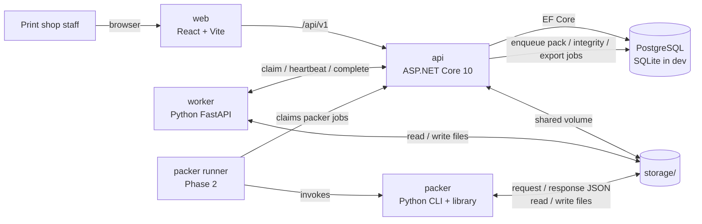

# PrintSheet Workbench — Architecture

Status: Phase 0 skeleton and frozen contracts. Phase 1 feature tracks are not
started.

This document describes the intended system. Code that does not exist yet is
marked by phase. The frozen interfaces live in `contracts/`; the domain rules
live in `docs/domain-model.md` and the ADRs.

---

## 1. Goals and constraints

PrintSheet is a human-in-the-loop workbench, not an unattended pipeline.

- A batch holds ~20 customer designs, often low-quality screenshots.
- Every processing step is optional and reviewable.
- Every processing step produces a new immutable version; originals are never
  overwritten. Reject, undo and revert-to-any-earlier-version always work.
- The master sheet is exactly 58 cm wide (configurable); height is variable and
  must be minimized because print cost scales with height.
- The packer never resamples, recolors or crops. It only translates and rotates
  by multiples of 90°.
- Export is blocked unless a blocking integrity report for the exact sheet
  revision passes.
- The GPU is a GTX 1650 Ti with 4 GB VRAM. GPU jobs run one at a time.
- The MVP is local (Docker Compose) and single-operator. Authentication and
  multi-tenancy are out of scope, except for the internal worker key.

---

## 2. System context



Component split:

| Component | Responsibility | Must not know |
| --- | --- | --- |
| `/api` | Domain state, version pointers, jobs, batch/sheet/export orchestration, HTTP | Image-processing internals |
| `/worker` | Trim, upscale, background removal, vectorize, resize, classify | Domain aggregates or sheet state |
| `/packer` | Mask nesting, placement, integrity checks, strip rendering | API/worker code or databases |
| `/web` | Review UI, crop/brush tools, packing preview | Filesystem paths or service secrets |

Files are exchanged through a shared storage directory. JSON carries relative
paths only. The single exception is the intake multipart upload, because a
browser must put the original somewhere; the API writes it directly into
storage and treats it as immutable.

---

## 3. Architectural principles

1. **Proposal, not mutation.** A processing request creates a `proposed`
   `DesignVersion`; approval moves the current pointer. No endpoint changes the
   pixels of an existing version.
2. **Copy-on-write files.** The original upload and every version file are
   write-once. Storage paths include batch/design/version IDs and are never
   reused.
3. **Explicit state machines.** Batch, design, version, sheet and job
   transitions live inside aggregates/domain services, not controllers.
4. **File-based ports.** `IFileStore`, `IImageProcessor`, `IPacker`,
   `ISheetExporter`, `IIntakeSource`.
5. **Conservative packing.** The packer may overestimate occupied area, never
   underestimate it. Faint alpha is occupied.
6. **Honest previews.** Transparency is composited in the browser over a
   checkerboard and selectable garment colors; the API never hides alpha
   artifacts behind a single white background.
7. **Expected failures are values.** Domain/application return explicit result
   types; exceptions are for bugs and infrastructure failures.
8. **Configurable, not magic.** Working DPI, margins, thresholds, grid size,
   export limits and price are options/env vars.
9. **Everything important is logged.** Jobs record parameters, attempts,
   durations and structured errors.
10. **No silent changes.** A step that can alter visible pixels must be
    reviewable and attributable to a version.

---

## 4. Deployment topology

### Docker Compose (default)

`docker compose up --build` starts:

| Service | Port | Notes |
| --- | --- | --- |
| `postgres` | internal 5432 | PostgreSQL for jobs and domain data |
| `api` | 8080 | ASP.NET Core; SQLite/Postgres provider switch |
| `worker` | 8000 | CPU image-processing skeleton; no GPU in Compose |
| `web` | 5173 | Vite dev server proxying API |

Shared volumes:

- `storage_data` mounted at `/data/storage` in API and worker.
- `postgres_data` for the database.

The packer is not a long-running service in Phase 0/1. It is a CLI/library
invoked by a job runner. In Phase 2, a lightweight packer runner claims
`pack-sheet`, `integrity-check` and `export` jobs and shells out to the CLI.

### Native fallback

GPU passthrough on Windows is painful, so the worker also runs natively:

- `scripts/run-worker-gpu.sh` sets `PRINTSHEET_GPU_ENABLED=true` and uses the
  host's `realesrgan-ncnn-vulkan` binary.
- GPU jobs are serialized by configuration (`max_gpu_jobs = 1`).
- The API and web can still run in Docker; the native worker points at
  `http://localhost:8080` and a shared storage directory.

---

## 5. API architecture (Clean Architecture)

```
api/src/
  PrintSheet.Domain/          aggregates, entities, value objects, invariants
  PrintSheet.Application/     use cases, ports, validators, result types
  PrintSheet.Infrastructure/  EF Core, PostgreSQL/SQLite, file store, HTTP clients
  PrintSheet.Api/             endpoints, auth, problem details, composition root
```

Dependency rule: Domain ← Application ← Infrastructure/Api. Domain has no EF
Core, ASP.NET, file-system or HTTP references. State transitions are methods on
aggregates; application services orchestrate transactions and jobs.

Ports (Phase 1):

| Port | Implementation |
| --- | --- |
| `IFileStore` | shared-volume file store; path validation, atomic writes |
| `IImageProcessor` | job enqueue adapter to the worker (not in-process) |
| `IPacker` | job enqueue adapter to the packer runner |
| `ISheetExporter` | packer/exporter adapter |
| `IIntakeSource` | manual upload now, Telegram later |
| `IJobQueue` | EF Core-backed Jobs table with leases |

Persistence: one `Batch` aggregate per batch, owned entities for designs and
versions, plus `Jobs`, `Exports`, `AuditEntries`, and `Settings`. Optimistic
concurrency on the batch row prevents two users from approving conflicting
versions. A single-operator MVP still gets the guard.

### API surface

The frozen OpenAPI 3.0.3 spec is `contracts/openapi/printsheet-api.yaml`.
Highlights:

- Batches: create/list/get/update; multipart intake.
- Designs: metadata, garment color, target size, exclude/include, better-source
  flag.
- Versions: list/download, approve, reject (returns next actions), revert.
- Steps: trim, crop, upscale, vectorize, background-removal, resize.
- Jobs: poll, cancel, batch listing.
- Sheets: pack, manual placements, integrity check, preview.
- Exports: request, list, get, download artifacts.
- Settings: working DPI, defaults, DPI warning thresholds, price, packer
  defaults.
- Internal: claim/heartbeat/complete/fail, protected by `X-Worker-Key`.

Expected failures use `application/problem+json` with stable `code` values
(`stale-proposal`, `sheet-integrity-failed`, `design-not-ready`, etc.).

---

## 6. Domain model in one page

The detailed state machine is in `docs/domain-model.md`.

`Batch` is the aggregate root. It owns `Design` entities; each `Design` owns its
immutable `DesignVersion` list and pointers. `Sheet` and `Export` are child
entities. A `Job` is a separate persistence concern.

Key invariants:

- Original version is always `approved` and immutable.
- At most one `proposed` version per design.
- A proposal's parent must equal the current version at proposal time. If the
  current pointer moves, the proposal is stale and must be rejected.
- A version becomes current only by approval; revert moves the pointer to an
  earlier approved version without changing files.
- `Design.status = ready` only if the current approved version is a `resize`
  that matches the target dimensions.
- `Batch.status` is `packed` only when a current sheet has `state=valid` and a
  passed integrity report for the same revision.
- Any design/version/target/geometry change invalidates the sheet.
- Export requires a valid sheet and passed integrity report for that revision.

Naming: JSON uses lowercase kebab-case for statuses/step types and camelCase
for fields. Domain C# enums are PascalCase and mapped explicitly.

---

## 7. Image pipeline and worker

### 7.1 Job envelope

The API generates `jobId`, assigns immutable input/output paths, writes a row,
and exposes it through the internal claim endpoint. The worker:

1. claims a job matching its capabilities and lease;
2. reads the input path from shared storage;
3. processes it;
4. writes output and artifacts atomically (temp file + rename);
5. posts a `WorkerResult` and marks the job succeeded/failed.

The canonical request/response envelopes and per-type parameters are
`contracts/jsonschema/worker-job.schema.json` and
`worker-result.schema.json`.

### 7.2 Steps

| Step | Implementation notes |
| --- | --- |
| Trim | Sample corners/edges to detect black/white/gray/transparent. Full-bleed (all four edges non-uniform) → no auto-crop proposal. Content touching the crop edge → warning. Manual crop uses the same worker job with explicit bounds; version step type is `crop`. |
| Upscale | `realesrgan-ncnn-vulkan`, models `realesrgan-x4plus` (photos) and `realesrgan-x4plus-anime` (illustrations/logos), 2× or 4×. GPU tile size tuned for 4 GB; one job at a time. Before/after slider in web. |
| Background removal | Three modes: AI cutout (rembg/BiRefNet), key-color-to-alpha (unmultiplied color so gradients keep correct alpha and no dark/white fringe), none. All produce a non-destructive mask artifact. Brush edits reuse the mask and append brush ops to version parameters. |
| Vectorize | potrace/vtracer for flat logos and line art. Produces an SVG artifact plus a preview raster version. Final resize can rasterize the SVG at target size/DPI. Before/after toggle. |
| Resize | Resample exactly once with Lanczos to `round(cm * dpi / 2.54)` pixels. Show effective source DPI; warn <150, strongly warn <100. Upscale is a separate proposal. |
| Classify | Heuristic features: flat-color ratio, edge density, unique-color count, sampled background, full-bleed detection. Suggests upscale model, vectorize candidate, and background-removal mode. Suggestions are always overridable. |

The original is never passed to a destructive operation. The worker writes only
the assigned new file paths.

### 7.3 GPU policy

- The target GPU has 4 GB VRAM. Upscale jobs request `gpu=true`; the worker uses
  tiling and a conservative tile size.
- The queue grants at most one `gpu` job per GPU worker at a time. The worker
  setting `max_gpu_jobs=1` is validated; the API also serializes by capability
  for a single GPU worker.
- CPU fallback is allowed for trim/background removal/vectorize/resize but not
  for a good Real-ESRGAN experience.

---

## 8. Packer

The packer is a standalone package/CLI with no imports from `/api` or
`/worker`:

```
printsheet_packer/
  contracts.py      load/validate request and response
  masks.py          alpha → conservative masks, dilation, grid
  nesting.py        placement search, rotations, randomized orderings
  integrity.py      four blocking checks
  render.py         strip/tile renderer, 90° transforms only
  export.py         flat PNG/TIFF, layered bundle, manifest
  cli.py            file-based entry point
```

### 8.1 Algorithm

1. Decode each approved design. Build an occupancy mask from alpha with a low
   threshold (default 5/255). This includes faint smoke and stray mist pixels.
   Keep real interior holes.
2. Dilate by `margin/2` so the visible pixels of any two designs are at least
   `margin` apart.
3. Downsample to an occupancy grid (default 5 mm cells). Round grid dimensions
   **up** so the grid never underestimates occupied area.
4. Place largest-area first at the lowest feasible position. Try rotations
   0/90/180/270 when `allowRotation`. Collision checks use vectorized NumPy
   (bitwise AND) or FFT/convolution.
5. Run N randomized orderings (default ~30) under a time budget; keep the
   shortest sheet. The RNG seed is recorded and deterministic.
6. Optional “no interlocking” mode uses convex hulls (Shapely) instead of raster
   masks.
7. Render from original full-resolution approved pixels, never from previews or
   downsampled masks. Rotations are 90° steps with no interpolation.
8. Sheets can be ~6850 × 59,000 px. Render and write in horizontal strips; never
   allocate the full canvas at once.

### 8.2 Integrity checks (blocking)

Fixed check IDs, all blocking:

| ID | Meaning |
| --- | --- |
| `visible-pixels-inside-sheet` | All visible pixels lie inside the sheet bounds. |
| `dilated-masks-no-overlap` | No two dilated masks overlap. |
| `minimum-gap` | Minimum visible-pixel gap ≥ configured margin. |
| `pixel-equality` | Each rendered placement crop is byte/pixel-identical to the source after the applied 90° rotation. |

`IntegrityReport.passed` is true only if all four are `passed`. `skipped` counts
as not passed. The report is machine-readable and stored with the sheet/export.
Export is blocked if the report is missing, stale, or failed.

### 8.3 Manual override

Web drag/rotate (90° steps) updates placements via the API. The sheet becomes
`unchecked`; live collision highlighting, sheet height, cost estimate and a mask
overlay are UI-side until the integrity check runs. A manual edit cannot change
pixels or resample.

---

## 9. Preview honesty

The browser composites the immutable RGBA version over:

- a checkerboard;
- white;
- black;
- a custom garment color (per-design `GarmentColor`, custom hex allowed).

This is not cosmetic. Fringes, halos, dark edge pixels, and semi-transparent
smoke are only visible when alpha is composited against real backgrounds. The
UI must offer at least checkerboard, white and black; custom is required for the
per-design garment color. The API serves immutable PNG bytes; the compositing is
client-side so it stays honest and cheap.

---

## 10. Export

Formats:

- Flattened transparent PNG at 300 DPI, written in horizontal strips with
  correct pHYs metadata.
- Flattened TIFF at 300 DPI, strip/tile-written.
- Layered export: see ADR 0003.
- Low-resolution preview.
- Placements manifest JSON (cm + px, rotation, source version IDs).

### PSD/PSB decision

The measured spike (ADR 0003) shows:

- classic PSD is limited to 30,000 px per side (~254 cm at 300 DPI);
- a realistic 500 cm tall sheet is ~59,000 px tall and requires PSB;
- `psd-tools` can emit a PSB with layers, but cannot composite/read rasters above
  the PSD limit, and its workaround relies on private state and leaves a stale
  preview.

Therefore the guaranteed layered deliverable is:

1. flat transparent PNG/TIFF;
2. JSON placements manifest;
3. a Photoshop ExtendScript `.jsx` that rebuilds the layered document from the
   manifest and source files.

True layered PSD/PSB stays optional until a strip-based writer and Photoshop
smoke tests exist. The export API exposes `psd-bundle` as the safe layered
format and `layered-psd`/`layered-psb` as format options that must be rejected
when limits are not validated.

---

## 11. Storage

```
storage/
  {batchId}/
    designs/{designId}/versions/{versionId}.png
    designs/{designId}/versions/{versionId}/mask.png
    designs/{designId}/versions/{versionId}/vector.svg
    jobs/{jobId}/...
    sheets/{sheetId}/{revision}/preview.png
    sheets/{sheetId}/{revision}/placements.json
    exports/{exportId}/...
```

Rules:

- All paths are relative and validated against traversal.
- Writes are atomic (temp + rename).
- Version files are never overwritten. Cleanup only removes unreferenced
  temporary/orphan files, never a version or export recorded in the database.
- The original upload and every approved version remain for revert/audit.
- The API and worker see the same root (`/data/storage` in Compose).

---

## 12. Job queue

ADR 0002 explains the choice. Summary:

- `Jobs` table in PostgreSQL (SQLite in dev); no external broker.
- Job fields: id, type, capability requirement (`image`/`packer`/`export`),
  status, parameters JSON, input/output paths, attempts, lease owner/token,
  lease expiry, timestamps, error.
- Claim is a short transaction with `FOR UPDATE SKIP LOCKED` (Postgres) or a
  guarded update (SQLite). Leases expire; retries are bounded; every attempt and
  duration is recorded.
- GPU capability is serialized: the claim query refuses a second running
  `gpu` job for the same GPU worker.
- Worker calls `claim`, optional `heartbeat`, then `complete` or `fail`.
- Packer jobs are claimed by a separate runner capability. This keeps the
  image worker independent.

---

## 13. Web architecture

- React 19 + TypeScript + Vite.
- Canvas-heavy: crop tool, brush editor, packing preview. Rendering uses
  device-pixel-ratio-aware canvases and zoom/pan without resampling the source.
- API client generated or hand-written from the frozen OpenAPI spec.
- No filesystem knowledge; downloads use API URLs.
- Preview backgrounds are CSS/canvas compositing over the returned RGBA file.
- Phase 1 D builds against a mock server generated from OpenAPI, not the real
  API; integration in Phase 2.

---

## 14. Configuration

Options classes/env vars, no magic numbers in logic:

- `Database:Provider` (`Postgres`/`Sqlite`), connection string.
- `Storage:Root`.
- Working DPI (default 300), roll width (58 cm), margin (30 mm), edge margin
  (0 mm).
- DPI warning thresholds (150 / 100).
- Packer: alpha threshold (5), cell size (5 mm), randomized orderings (30),
  time budget.
- Price per cm and currency.
- Worker: API URL, worker key/id, capabilities, GPU enabled, max GPU jobs (1),
  Real-ESRGAN binary path, tile size.
- Export: layered size limits, strip height, compression.

Settings are exposed through `/api/v1/settings`; batch geometry and DPI are
snapshotted on the batch so re-opening an old batch is reproducible.

---

## 15. Observability

- Structured logs (JSON in containers) with job id, batch id, design id, step
  type, attempt, duration and outcome.
- Every job stores its parameters and duration; the UI shows history.
- Integrity reports are stored, not just logged.
- Health endpoints: API includes database connectivity; worker includes storage
  writability and capabilities.
- No image bytes or customer file names in logs beyond opaque IDs where
  possible.

---

## 16. Security and data handling

- Internal tool, no staff authentication in the MVP; deploy on a trusted LAN.
- Internal endpoints require a shared worker key. The key is never sent to the
  browser.
- Upload validation: MIME sniffing, dimension limits, decompression-bomb
  limits.
- Path traversal blocked at `IFileStore`.
- The API serves immutable files with ETags; filenames are IDs, not user input.
- Customer artwork is confidential; no third-party upload from the worker.
  AI models run locally.

---

## 17. Testing strategy

| Layer | Tests |
| --- | --- |
| Domain | Unit tests for every state transition, readiness, stale proposal, revert, size math, sheet invalidation. No infrastructure. |
| API | Integration tests with SQLite/in-memory DB, fake worker, fake packer, fake file store. Contract tests against OpenAPI. |
| Worker | Unit tests for trim sampling, C2A alpha math, brush mask, resize pixel math, classifier features; golden image tests. |
| Packer | Heaviest tests: mask construction, conservative grid, rotations, holes, faint pixels, single design, 40 designs, over-wide designs, property-based invariants. |
| Integrity | Adversarial cases: ring with hole, stray faint pixel, smoke gradient, tall design, overlap, crop mismatch. |
| Export | Pixel equality, DPI metadata, strip boundaries, layered bundle/JSX. |
| Web | Component tests for crop/brush; visual checks for preview backgrounds; packing preview interactions. |
| E2E | `/fixtures` end-to-end after Phase 2 integration. |

Fixture inputs cover: full-bleed collage, white-on-black smoke, flat logo on
black with margins, thin signature on gray at ~80 DPI, pale misty art on white,
transparent sticker with fringe, tall banner.

---

## 18. Phase roadmap

- **Phase 0 (this phase):** skeleton, Compose, contracts, domain doc, ADRs, PSD
  spike, fixtures, one-command startup.
- **Phase 1 A:** domain + state machine + versioning + jobs against a fake
  worker.
- **Phase 1 B:** worker image steps, CLI-testable.
- **Phase 1 C:** packer library, integrity, exporters, property-based tests,
  benchmark.
- **Phase 1 D:** web wizard/crop/brush/batch/packing preview against mock API.
- **Phase 2:** integration, E2E on fixtures, settings page, cleanup of old
  files, packer runner.

Track boundaries are strict. Contract changes require updating the schema, the
examples, this document if structural, and notifying the other tracks.

---

## 19. Open risks

1. **Layered export at 59,000 px.** `psd-tools` is not strip-based and cannot
   read/composite above 30,000 px. The manifest + JSX bundle is the safe path;
   a custom PSB writer is future work and needs Photoshop validation.
2. **GPU driver variance.** Real-ESRGAN ncnn Vulkan behavior differs by driver;
   tile size and OOM handling need real-machine tuning.
3. **Background removal quality.** AI models may destroy thin lines or soft
   smoke; the brush editor and mode switching are mandatory, not optional.
4. **Packing performance.** 40 designs on a 500 cm sheet must stay within
   seconds-to-a-minute; the time-boxed randomized search and vectorized masks
   are the mitigation.
5. **Full-bleed detection.** Edge sampling must be robust to JPEG noise and
   screenshots; false positives must never crop artwork.
6. **Color management.** MVP assumes sRGB. ICC profiles and CMYK workflows are
   out of scope; this must be visible in the UI.
7. **No authentication.** Acceptable only for a trusted local deployment.
