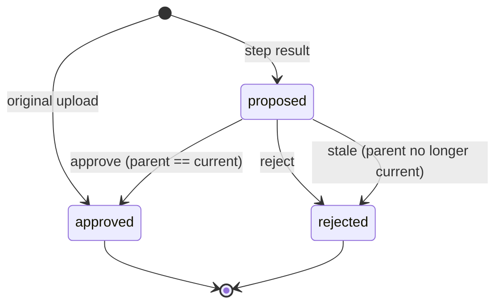
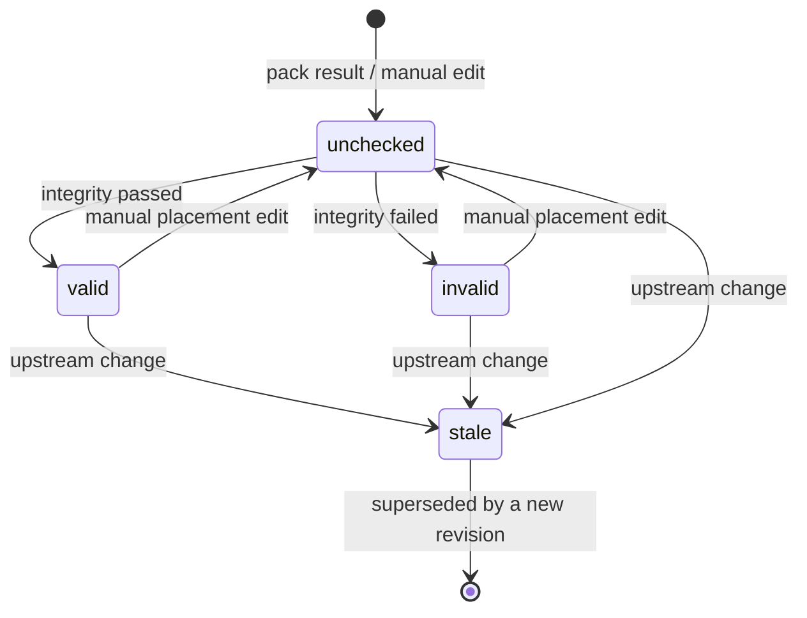
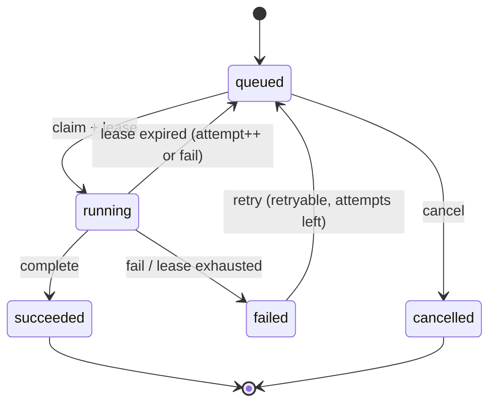

# PrintSheet Workbench — Domain Model

Status: Phase 0, frozen enough for Phase 1 implementation.
Contract version: **1.0.0**.

This document defines the aggregates, value objects, state machines and
invariants. When code and this document disagree, stop and resolve the
disagreement before merging. The HTTP shape is in
`contracts/openapi/printsheet-api.yaml`; the service payloads are in
`contracts/jsonschema/`.

---

## 1. Ubiquitous language

| Term | Meaning |
| --- | --- |
| **Batch** | One customer order: ~20–40 designs packed onto one or more sheets. Aggregate root. |
| **Design** | One piece of customer artwork inside a batch. Owns an immutable version history. |
| **DesignVersion** | One immutable processing result: a file plus step type, parameters, parent and status. |
| **Current version** | The approved version the rest of the system treats as the design's pixels. A pointer, not a mutation. |
| **Proposal** | A `proposed` version awaiting human approval. At most one per design. |
| **Step** | A processing operation that can change visible pixels: trim, crop, upscale, resize. Historical `vectorize`/`background-removal` values remain readable. |
| **Sheet** | A packing result for a batch at one revision: placements, geometry and integrity state. |
| **Placement** | Translation + 90° rotation of an approved version on the sheet. No resampling. |
| **Integrity report** | Machine-readable result of five blocking pre-export checks. |
| **Export** | A rendered deliverable for one sheet revision. Blocked unless integrity passed. |
| **Job** | A queued unit of work (image processing, packing, integrity check, export) with a lease. |
| **Garment color** | Preview-only background used to judge edges/halos. Never baked into artwork. |

Statuses and step types are lowercase kebab-case in JSON and PascalCase in C#.
Field names are camelCase in JSON.

---

## 2. Bounded contexts

| Context | Owns | Does not own |
| --- | --- | --- |
| **Intake & review** (API) | Batch/design/version state, approvals, target sizes | Pixel algorithms |
| **Image processing** (worker) | Trim, crop, upscale, resize, classify | Batch state, approvals, sheet packing |
| **Packing & export** (packer) | Alpha geometry, nesting, integrity checks, rendering, artifacts | Version approval, database |
| **Workbench UI** (web) | Review, crop interaction, placement editing, previews | File storage, secrets, domain transitions |

The API is the only writer of domain state. Worker and packer are stateless
processes that read and write files at paths assigned by the API and report
results back. The packer is a library/CLI; a runner (Phase 2) adapts it to the
job queue.

---

## 3. Aggregates

### 3.1 Batch (aggregate root)

A `Batch` owns:

- `Design` entities (identity: `designId`);
- `Sheet` entities, one current sheet plus revision history;
- `Export` records;
- batch geometry and working DPI, snapshotted at creation;
- audit entries for state changes.

Why one aggregate: the MVP has 20–40 designs and modest version counts. The
whole batch fits comfortably in memory and in one transaction. Packing and
export need a consistent view of every design's current version and target
size; splitting designs into separate aggregates would require a saga for a
problem we do not have. If batches grow beyond a few hundred designs, revisit
this before adding concurrency, not after.

`Job` is a **separate** persistence concern. It references batch/design IDs but
is not owned by the aggregate; jobs are leased and updated concurrently by
workers. A job completion is applied to the batch in its own transaction.

`Settings` is a separate singleton.

### 3.2 Design (entity)

Identity: `designId` (UUID), unique within the batch.

Fields:

- `name` (display name, editable);
- `status` (`received`, `in-progress`, `ready`, `needs-better-source`,
  `excluded`);
- `garmentColor` (preview only: light, dark, custom hex);
- `allowRotation` (packer hint, default true);
- `targetWidthCm`, `targetHeightCm` (nullable until chosen);
- `originalVersionId` (never changes);
- `currentVersionId` (approved pointer);
- `pendingVersionId` (nullable; the single proposed version);
- `betterSourceRequested` (boolean, survives include/exclude);
- `notes`;
- ordered version list (newest first for display, parent links for history).

`Design` does not own a mutable pixel buffer. It owns metadata and pointers; the
file lives in shared storage and is write-once.

### 3.3 DesignVersion (entity)

Identity: `versionId` (UUID), globally unique. Immutable after creation except
for its status (`proposed` → `approved` | `rejected`) and audit timestamps.

Fields:

- `designId`, `parentId` (null only for the original);
- `stepType`: `original`, `trim`, `crop`, `upscale`, `resize`; historical
  `vectorize` and `background-removal` values remain readable;
- `status`: `proposed`, `approved`, `rejected`;
- `filePath` (relative to storage root), `maskPath`, `svgPath` (nullable;
  historical artifacts only);
- `widthPx`, `heightPx`, `hasAlpha`;
- `parameters` (exact, immutable JSON: crop rect, model, scale, tolerance,
  target box, DPI, fit mode, …);
- `createdAt`, `approvedAt`, `rejectedAt`, `rejectionReason`;
- `jobId` that produced it (nullable for original).

The only legal status transitions are:

```
proposed ──approve──▶ approved
proposed ──reject───▶ rejected
```

`approved` and `rejected` are terminal. Revert never changes a version's
status; it only moves the design's current pointer.

### 3.4 Sheet (entity)

One packing result at a `revision` (1-based). Fields:

- `sheetId`, `batchId`, `revision`;
- `widthCm`, `heightCm`, `widthPx`, `heightPx`, `dpi`;
- `placements` (each: designId, versionId, xCm, yCm, widthCm, heightCm,
  widthPx, heightPx, rotationDeg ∈ {0, 90, 180, 270});
- `state`: `unchecked`, `valid`, `invalid`;
- `stale`: true when upstream inputs changed after this sheet was produced;
- `integrityReport` (nullable; only for this exact revision);
- `estimatedCost` (amount + currency);
- timestamps.

`state` answers “does a passed integrity report exist for this revision?”;
`stale` answers “does this revision still correspond to the current designs,
targets and batch geometry?”. A sheet can be `valid` and `stale` at the same
time; export is blocked in that case.

### 3.5 Export (entity)

Fields: `exportId`, `batchId`, `sheetId`, `sheetRevision`, `format`, `status`,
`dpi`, artifacts, embedded integrity report, `blockedReason`, `error`,
timestamps.

`status` ∈ `queued`, `running`, `succeeded`, `failed`, `blocked`. Export is
blocked at request time (HTTP 409) if the sheet is stale, not `valid`, or has no
passed report for the same revision. A job that later finds a changed sheet
fails without producing artifacts.

### 3.6 Job (separate persistence concern)

Fields: `jobId`, `batchId`, `designId` (nullable), `type`, `status`,
`capability` (`image` | `gpu` | `packer` | `export`), `parameters` JSON,
input/output paths, `attempts`, `maxAttempts`, lease owner/token/expiry,
timestamps, structured error.

`status` ∈ `queued`, `running`, `succeeded`, `failed`, `cancelled`.

Job types:

- image processing: `classify`, `trim`, `upscale`, `resize`;
- orchestration: `pack-sheet`, `integrity-check`, `export`.

Only the four supported image-processing types are queued. Historical
`background-removal`/`vectorize` documents remain schema-valid but the worker
rejects new runs with a structured `retired` reason.

---

## 4. Value objects

### 4.1 Batch geometry

```
BatchGeometry {
  rollWidthCm      // exact sheet width, default 58
  marginMm         // minimum visible gap between designs, default 30
  edgeMarginMm     // gap from the sheet edge, default 0
  workingDpi       // default 300, immutable per batch
}
```

All geometry is validated: `rollWidthCm > 0`, `marginMm ≥ 0`,
`edgeMarginMm ≥ 0`, `72 ≤ workingDpi ≤ 1200`. The working DPI is snapshotted
when the batch is created. Changing the global default does not rewrite an
existing batch.

### 4.2 PrintSize / target size

Physical size in cm plus pixel size at a DPI. The canonical conversion:

```
pixels = roundHalfAwayFromZero(cm * dpi / 2.54)
```

`PrintUnits.PixelsForCentimeters` in
`api/src/PrintSheet.Domain/Units/PrintUnits.cs` implements this and is the only
conversion allowed. 58 cm × 300 DPI → 6850 px. Never round separately in
controllers or UI.

Effective DPI of a source at a target size:

```
effectiveDpi = min(
  widthPx  / (targetWidthCm  / 2.54),
  heightPx / (targetHeightCm / 2.54)
)
```

Warnings are configurable:

- `< dpiWarnBelow` (default 150) → warning;
- `< dpiStrongWarnBelow` (default 100) → strong warning.

Warnings never block. Low effective DPI is a reason to propose upscale or to
request a better source, not a reason to silently enlarge.

### 4.3 GarmentColor

`{ kind: light | dark | custom, hex? }`. Custom requires a hex color. It is a
preview background only; it is never written into a version or export.

### 4.4 CropRect

`{ x, y, width, height }` in pixels, top-left origin, inside the parent’s pixel
bounds. Used by both auto-trim results and manual crop commands.

### 4.5 IntegrityReport

`{ schemaVersion, reportId, generatedAt, passed, sheet, checks[], failures[],
metrics }`. New reports use `schemaVersion` `2.0` with five blocking check IDs:

1. `visible-pixels-inside-sheet`
2. `dilated-masks-no-overlap`
3. `minimum-gap`
4. `pixel-equality`
5. `all-designs-placed`

`passed` is true only when all five are `passed` and no requested design is
unplaced. A `skipped` check or a `not-selected` subset omission means the report
is **not** passed. Historical `1.0` reports with four checks remain readable but
cannot satisfy the five-check export gate.

### 4.6 Money

`{ amount, currency }` for the sheet cost estimate. Currency is a three-letter
code. Cost is `pricePerCm × sheetHeightCm` (plus configured extras, if any).

---

## 5. State machines

### 5.1 Design status

```mermaid
stateDiagram-v2
    [*] --> received: upload original
    received --> in-progress: first step approved
    received --> excluded: exclude
    in-progress --> ready: approve matching resize
    ready --> in-progress: approve earlier step / revert / target change
    in-progress --> needs-better-source: request better source
    ready --> needs-better-source: request better source
    needs-better-source --> in-progress: resume (current not matching resize)
    needs-better-source --> ready: resume (current matching resize)
    received --> needs-better-source: request better source
    excluded --> received: include (no step approved yet)
    excluded --> in-progress: include (non-resize current)
    excluded --> ready: include (matching resize current)
    excluded --> needs-better-source: include (flag still set)
```

Rules:

- A new design starts `received` with the original as current and approved.
- `ready` ⇔ the current version is `approved`, `stepType = resize`, and its
  `widthPx`/`heightPx` equal the pixels for the design's target cm at the
  batch DPI.
- `needs-better-source` is a sticky flag. `resume` clears it and recomputes the
  status from the current version.
- `excluded` designs are ignored by readiness and packing. Excluding a ready
  design invalidates a sheet but does not delete anything.
- A target-size change recomputes status; a ready design drops to
  `in-progress` until a matching resize is approved.

### 5.2 Version status



Invariants:

1. Exactly one `original` version per design; it is `approved` and immutable.
2. At most one `proposed` version per design (`pendingVersionId`).
3. A proposal is created with `parentId = currentVersionId` at proposal time.
4. A proposal may be approved only while its parent is still current.
5. If the current pointer moves for any reason, any proposal whose parent is no
   longer current becomes `rejected` with `reason = stale-parent`. It is never
   rebased onto the new current version.
6. Version files are write-once. Reject/revert never delete a file.

### 5.3 Batch status

```mermaid
stateDiagram-v2
    [*] --> collecting: create batch
    collecting --> ready-to-pack: every non-excluded design ready
    ready-to-pack --> collecting: design/target/geometry change
    ready-to-pack --> packed: pack succeeds + integrity passes
    collecting --> packed: (not allowed; readiness precondition)
    packed --> collecting: sheet invalidated and inputs not all ready
    packed --> ready-to-pack: sheet invalidated but inputs still ready
    packed --> exported: export succeeds
    exported --> collecting: any invalidation
    exported --> ready-to-pack: invalidation, inputs still ready
```

`batch.status` is derived, never set by a client:

- `collecting`: at least one non-excluded design is not ready, or there is no
  sheet yet and the batch has never been packed;
- `ready-to-pack`: at least one non-excluded design exists, all non-excluded
  designs are ready, and there is no current valid non-stale sheet;
- `packed`: a current sheet exists, is not stale, `state = valid`, and its
  integrity report passed for the same revision;
- `exported`: at least one export for the current sheet revision succeeded.

Any invalidation recomputes the status. The API exposes it; the UI must not
cache it as truth.

### 5.4 Sheet



- Packing creates a new revision, `state = unchecked`, `stale = false`.
- Manual placement edits keep the geometry but increment the revision, clear the
  integrity report and set `state = unchecked`.
- The integrity check runs on a fixed revision. If the revision changes before
  the result is applied, the result is discarded (`stale-revision`).
- Upstream changes set `stale = true` on the current sheet and clear export
  eligibility. They do not mutate placements.

### 5.5 Job



- Claim is transactional. A lease has a token and an expiry.
- A heartbeat extends the lease; a stale token cannot complete a job.
- Cancel is only allowed while `queued`; cancelling a running job returns 409.
- Retry is bounded (`maxAttempts`, default 3). The error carries
  `retryable`.
- GPU jobs are serialized: no second `running` job with `capability = gpu` on
  the same GPU worker. The image worker’s `max_gpu_jobs = 1` is validated at
  startup.

### 5.6 Export

```
queued → running → succeeded
                 ↘ failed
queued/running  → blocked (precondition lost)
```

An export request validates the current sheet **before** enqueueing. If the
sheet is stale, `state != valid`, or the report is missing/failed for the
revision, the API returns 409 `sheet-integrity-failed` and creates no job. If
the sheet changes while the job runs, the job fails `stale-sheet`.

---

## 6. Commands and transitions

All commands are idempotent where practical and record an audit entry with
actor, timestamp, entity IDs and a before/after summary.

### 6.1 Intake

`UploadDesign(batchId, file, metadata)`

1. Validate MIME/extension, decode, enforce dimension and byte limits.
2. Write the original bytes to an immutable path:
   `{batchId}/designs/{designId}/versions/{versionId}.png`.
3. Create the design (`received`) and the `original` version (`approved`,
   current, parent null).
4. Enqueue `classify`.
5. Invalidate the current sheet if one exists.

Uploads never overwrite. Re-uploading the same artwork creates a new design.

### 6.2 Processing proposal

`Propose<Step>(designId, parameters)` for trim, crop, upscale, resize:

1. Require the design not excluded and not `needs-better-source`.
2. Require no existing `proposed` version; otherwise 409
   `proposal-in-flight`.
3. Snapshot `parentId = currentVersionId`, the parent file path, target box,
   batch DPI and garment color into the job.
4. Create the output path for a new version ID now; the path is reserved and
   never reused.
5. Enqueue the job. Return 202 with the job ID.

When the worker completes:

1. Validate the result against `worker-result.schema.json`; verify the output
   file exists, decodes, and matches declared dimensions.
2. Re-check that `parentId` is still the current version. If not, fail the job
   `stale-source` (non-retryable) and leave the output unreferenced.
3. Create the `proposed` version and set `pendingVersionId`.
4. Keep the current pointer unchanged. The design becomes `in-progress` only
   after the first approval, not on proposal.

Manual crop is a `trim` job with `mode = manual` and an explicit `cropRect`;
the resulting version’s `stepType` is `crop`. The contract keeps the job type
set small while preserving the review semantics.

### 6.3 Approve

`ApproveVersion(designId, versionId)`

Preconditions:

- version belongs to the design and is `proposed`;
- version’s parent is the current version;
- version file still exists and passes a cheap integrity check (decodable,
  dimensions match parameters);
- for `resize`, the pixel size matches the target cm at the batch DPI.

Effects, in one transaction:

1. version → `approved`, `approvedAt = now`;
2. current pointer → version;
3. `pendingVersionId = null`;
4. recompute design status;
5. invalidate the current sheet;
6. audit.

Approving anything other than the final resize leaves the design
`in-progress`. Approving a matching resize makes it `ready`.

### 6.4 Reject

`RejectVersion(designId, versionId, reason?)`

Preconditions: version is `proposed`.

Effects: version → `rejected`, `pendingVersionId = null`, current pointer
unchanged, audit. Response offers `adjust-parameters`, `manual-tool`, `skip`.
Rejecting never deletes the file and never changes the current version.

### 6.5 Revert / undo

`RevertVersion(designId, targetVersionId)`

Preconditions: target belongs to the design, is `approved`, and is not the
current version.

Effects:

1. current pointer → target;
2. any pending proposal becomes `rejected` (`stale-parent`);
3. recompute status: `ready` only if target is a resize matching target
   dimensions, otherwise `in-progress`;
4. invalidate the current sheet;
5. audit.

`Undo` is sugar for reverting to the parent of the current version. It follows
the same rules and does not create a version.

### 6.6 Target size and metadata

`UpdateDesign` may change name, notes, garment color, rotation permission and
target cm. Target change:

- clears readiness (recompute);
- invalidates the current sheet;
- does **not** delete or rewrite any version;
- does **not** auto-propose a resize. The UI can offer one.

### 6.7 Pack

`PackSheet(batchId, options)`

Preconditions:

1. at least one non-excluded design;
2. every non-excluded design is `ready`;
3. no design has a target width wider than `rollWidthCm` minus edge margins.
   If one does, return 422 `design-exceeds-roll` with the design ID and the
   maximum allowed width. The operator must explicitly scale the target or
   exclude the design; the packer never scales.

Effects: enqueue `pack-sheet`, snapshot the batch geometry, current version IDs
and target sizes into the job. On success, create a new sheet revision,
`state = unchecked`, `stale = false`. The packer response is validated against
`packer-response.schema.json`; placements must reference the snapshotted
versions.

### 6.8 Manual placements

`UpdatePlacements(batchId, revision, placements)`

- Revision must equal the current sheet revision (optimistic concurrency).
- Every placement references a ready design and its current version.
- Geometry must be inside the sheet; rotation ∈ {0, 90, 180, 270}; no
  resampling fields.
- Increment revision, clear integrity report, `state = unchecked`,
  `stale = false`.
- The server may accept a geometrically overlapping arrangement so the UI can
  show the collision; only the integrity check decides `invalid`.

### 6.9 Integrity check

`RunIntegrityCheck(batchId)` snapshots the sheet revision and placements,
enqueues `integrity-check`, and applies the report only if the revision still
matches. On pass: `state = valid`, batch may become `packed`. On failure:
`state = invalid`, batch returns to `ready-to-pack` (inputs are still ready) or
`collecting`.

### 6.10 Export

`CreateExport(batchId, format, includePreview)`

Preconditions:

- current sheet exists, `stale = false`, `state = valid`;
- integrity report passed and `report.sheet` matches the sheet geometry and
  revision;
- format is allowed for this sheet size (ADR 0003: `layered-psd` only at
  ≤ 30,000 px per side; `layered-psb` only when the writer is validated);
- formats `flat-png`, `flat-tiff`, `psd-bundle`, `preview` are always allowed
  within configured size limits.

Effects: enqueue `export`. On success: store artifacts, mark export
`succeeded`, batch `exported`. On failure: `failed` with a structured error and
no partial artifacts exposed.

### 6.11 Exclude / include / better source / resume

- `ExcludeDesign`: status `excluded`; invalidate sheet; readiness recomputed.
- `IncludeDesign`: clear `excluded`; restore flag/status from current version
  and `betterSourceRequested`; invalidate sheet.
- `RequestBetterSource`: set flag; status `needs-better-source`; invalidate
  sheet; the design is no longer ready.
- `ResumeDesign`: clear flag; recompute status from current version; invalidate
  sheet if the status changed.

---

## 7. Invariants (must be enforced in Domain/Application)

1. Original upload is never modified or overwritten.
2. Every step writes a new file at a new version path.
3. Only `approved` versions can be current.
4. At most one `proposed` version per design.
5. A proposal’s parent must be current when proposed and when approved.
6. A stale proposal is rejected, never rebased.
7. `design.ready` requires an approved resize matching the declared target cm
   at the batch DPI.
8. Batch packing requires every non-excluded design ready.
9. Any change to current version, target size, inclusion, rotation permission
   or batch geometry marks the current sheet stale.
10. Export requires a non-stale, valid sheet and a passed report for the same
    revision.
11. Integrity report check IDs and blocking semantics are fixed; skipped ≠
    passed.
12. Packer placements use only 90° rotations and translation; no resampling,
    recoloring or cropping.
13. The packer renders from full-resolution approved files, never previews.
14. Designs wider than the roll are rejected or explicitly resized by the
    operator; never silently scaled.
15. Preview backgrounds never alter files.
16. All sizes round through `PrintUnits`; no local rounding.
17. IDs are UUIDs; timestamps are ISO-8601 UTC.
18. Audit entries are append-only.

---

## 8. Persistence sketch

Tables (Phase 1 A may refine column types but not semantics):

| Table | Key columns |
| --- | --- |
| `batches` | id, name, status, roll_width_cm, margin_mm, edge_margin_mm, working_dpi, row_version, created_at, updated_at |
| `designs` | id, batch_id, name, status, garment_kind, garment_hex, allow_rotation, target_width_cm, target_height_cm, original_version_id, current_version_id, pending_version_id, better_source_requested, notes |
| `design_versions` | id, design_id, parent_id, step_type, status, file_path, mask_path, svg_path, width_px, height_px, has_alpha, parameters_json, job_id, created_at, approved_at, rejected_at, rejection_reason |
| `sheets` | id, batch_id, revision, state, stale, width_cm, height_cm, width_px, height_px, dpi, integrity_report_json, estimated_cost_amount, currency, created_at, updated_at |
| `placements` | sheet_id, design_id, version_id, x_cm, y_cm, width_cm, height_cm, width_px, height_px, rotation_deg |
| `jobs` | id, batch_id, design_id, type, capability, status, parameters_json, input_path, output_path, attempts, max_attempts, lease_owner, lease_token, lease_expires_at, error_json, timestamps |
| `exports` | id, batch_id, sheet_id, sheet_revision, format, status, integrity_report_json, blocked_reason, error_json, timestamps |
| `settings` | singleton row; typed columns or JSON |
| `audit_entries` | id, batch_id, design_id, version_id, action, actor, reason, details_json, created_at |

Concurrency:

- `batches.row_version` is an optimistic concurrency token. Approve/reject/
  revert/update commands load the batch, validate, mutate, and save; a conflict
  returns 409.
- Job claim uses `FOR UPDATE SKIP LOCKED` on PostgreSQL and a guarded update on
  SQLite.
- Integrity/export results are applied only if the sheet revision still
  matches the snapshot.

Indexes: `designs(batch_id)`, `design_versions(design_id, created_at)`,
`jobs(status, capability, created_at)`, `jobs(lease_expires_at)`,
`sheets(batch_id, revision)`, `exports(batch_id, created_at)`.

---

## 9. Error codes

Stable machine-readable codes in `ProblemDetails.code`:

| Code | HTTP | Meaning |
| --- | --- | --- |
| `batch-not-found` / `design-not-found` / `version-not-found` | 404 | Missing resource |
| `proposal-in-flight` | 409 | A proposed version already exists |
| `stale-proposal` | 409 | Proposal parent is no longer current; reject and re-run |
| `invalid-transition` | 409 | Command not legal in the current state |
| `version-not-approved` | 409 | Revert target is not approved |
| `design-not-ready` | 409 | Pack requested while a design is unfinished |
| `design-exceeds-roll` | 422 | Target width > usable roll width |
| `batch-not-ready` | 409 | Pack requested before readiness |
| `sheet-not-found` | 404 | No current sheet |
| `sheet-stale` | 409 | Upstream inputs changed; repack |
| `sheet-integrity-failed` | 409 | No passed report for this revision |
| `stale-revision` | 409 | Result applied to an outdated sheet revision |
| `stale-source` | 409 | Worker result’s parent is no longer current |
| `invalid-target-size` | 422 | Non-positive/absurd target or mismatch |
| `export-format-unavailable` | 422 | Format not allowed for this sheet size |
| `worker-key-invalid` | 401 | Missing/incorrect `X-Worker-Key` |
| `upload-too-large` | 413 | Intake size limit exceeded |
| `unsupported-image` | 422 | Decode/MIME/dimension rejection |

---

## 10. Worked example

A 20-design batch at 58 cm wide, 300 DPI, 30 mm margin.

1. Operator creates the batch; geometry is snapshotted (58 cm, 30 mm, 300 DPI).
2. Uploads 20 PNGs. Each becomes an `original` design version; classify jobs
   are queued. Designs are `received`.
3. For design A, the classifier suggests a trim and a 4× upscale. The operator
   approves the trim (`in-progress`), reviews the upscale preview, rejects one
   over-smoothed proposal (offered adjust/manual/skip), and accepts a second
   upscale.
4. Target is 20 × 15 cm. The final resize produces 2362 × 1772 px
   (`round(20 × 300 / 2.54) = 2362`, `round(15 × 300 / 2.54) = 1772`).
   Effective DPI from the upscaled source is computed and shown; approving the
   resize makes design A `ready`.
5. Repeat for all included designs. The last one to become ready flips the
   batch to `ready-to-pack`.
6. Pack. Placements are generated; the sheet is `unchecked`.
7. Integrity check passes: `state = valid`; batch `packed`.
8. Operator visually reviews the sheet preview and cost.
9. Export `flat-png` + `psd-bundle`. Export succeeds; batch `exported`.
10. Customer asks to swap one design's target size. The target change
    invalidates the sheet, the design drops to `in-progress`, and the batch
    leaves `exported`. Repacking requires a new matching resize approval and a
    new integrity report; the old export remains available as history.

---

## 11. Open questions for Phase 1

These do not block the frozen contract but must be decided with the user:

1. **Batch lock after export.** The model allows edits after export and treats
   the old export as history. If the shop needs an immutable “sent to printer”
   lock, add an explicit lock command rather than overloading `exported`.
2. **Automatic resize on target change.** The current rule never auto-proposes.
   The UI can offer a one-click proposal; the domain should not create one
   silently.
3. **Multiple sheets per batch.** The model names a current sheet; a batch that
   exceeds one roll would need a sheet list and a split policy. Phase 1 can
   return `sheet-too-tall` and require exclusion/repacking; do not add multiple
   sheets without a contract change.
4. **Actor identity.** No staff auth in the MVP. `audit_entries.actor` is a
   display label (“operator”), not an authenticated user.
5. **Color management.** sRGB only. ICC/CMYK is out of scope and must be
   stated in the UI.
